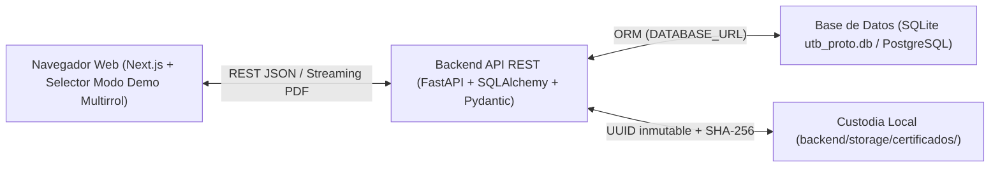
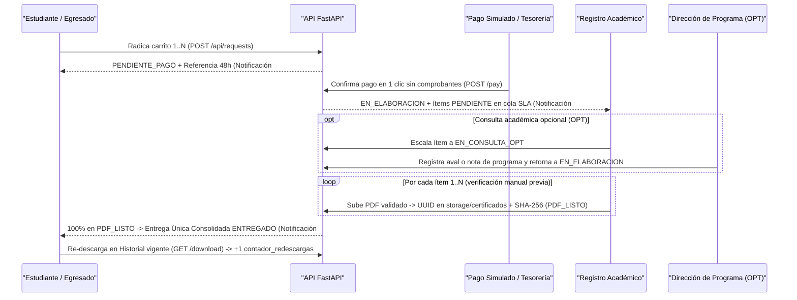

# Arquitectura Técnica del Prototipo (MVP) — Certificados Académicos UTB

Diseño técnico ligero, modular y ejecutable en local por un único desarrollador para demostrar el ciclo completo de solicitud, liquidación previa, validación financiera, expedición manual verificada y custodia post-entrega de certificados académicos UTB, sin buckets en la nube ni colas de mensajería externas.

## 1. Stack del Prototipo y Por Qué es Ligero

La arquitectura prioriza cero fricción operativa (`RNF-01`) manteniendo capas desacopladas listas para evolución institucional (`RNF-05`):

- **Frontend — Next.js (App Router + TypeScript + Tailwind CSS):**
  Aplicación web responsiva (`RNF-04`) con una barra superior persistente de **Modo Demo Multirrol** (`RN-04`, `RF-01`) que alterna en un clic entre `Estudiante / Egresado` (activo o egresado), `Tesorería`, `Auxiliar de Registro Académico` y `Dirección de Programa` consumiendo la misma API REST.
- **Backend — FastAPI + SQLAlchemy + Pydantic:**
  Monolito modular en Python con validación estricta de esquemas, reglas de estado transaccionales (`RN-01`..`RN-05`) y liquidación monetaria exacta en enteros `COP` (`RNF-03`), operando de forma síncrona sin brokers ni colas de mensajería externas.
- **Base de Datos — SQLite local compatible con PostgreSQL:**
  Persistencia inmediata en el archivo local `backend/utb_proto.db` mediante **SQLite** sin instalar motores externos. El acceso por ORM (**SQLAlchemy**) mantiene compatibilidad directa para apuntar a **PostgreSQL** en despliegue institucional cambiando únicamente la variable `DATABASE_URL`.
- **Custodia Local de PDFs sin Buckets (`backend/storage/certificados/`):**
  Los certificados subidos manualmente por Registro Académico (`RN-01`, `RF-07`) se guardan en la carpeta controlada `backend/storage/certificados/` nombrando cada archivo con un UUID inmutable (`<id_documento>.pdf`). Tras la entrega queda en solo-lectura lógica (`RNF-02`), respaldado en la tabla `documents` con sus metadatos clave (`id_documento`, `numero_radicado`, `id_titular`, `tipo_certificado`, `fecha_expedicion`, `fecha_vigencia`, `hash_sha256`, `ruta_archivo`, `contador_redescargas`).

## 2. Diagramas de Arquitectura y Flujo Operativo

### 2.1 Componentes del Prototipo Local



### 2.2 Secuencia de Extremo a Extremo (Radicación a Re-descarga)



## 3. Modelo de Datos Mínimo (5 Tablas Relacionales)

1. **`catalog_items`** — Catálogo tarifario configurable (`RF-02`):
   `id` (PK), `codigo` (único), `nombre`, `precio_cop` (entero exacto), `sla_dias_habiles`, `dias_vigencia`, `requiere_opt` (bool), `activo` (bool).
2. **`requests`** — Cabecera del expediente por radicado (`RF-03`, `RN-02`, `RN-03`):
   `id` (PK), `numero_radicado` (único), `id_titular`, `nombre_titular`, `perfil_titular` (`ESTUDIANTE` | `EGRESADO`), `referencia_pago`, `total_cop`, `sla_max_dias`, `estado` (`PENDIENTE_PAGO`, `EN_ELABORACION`, `EN_CONSULTA_OPT`, `ENTREGADO`, `EXPIRADO`), `expira_pago_en` (+48 horas), `fecha_limite_sla`, `cumplio_sla` (bool nullable), `creado_en`, `pagado_en`, `entregado_en`.
3. **`request_items`** — Detalle por certificado dentro del carrito (`RF-05`, `RF-06`, `RN-05`):
   `id` (PK), `request_id` (FK `requests.id`), `catalog_item_id` (FK `catalog_items.id`), `precio_unitario_cop`, `estado_item` (`PENDIENTE`, `OBSERVADO`, `EN_CONSULTA_OPT`, `PDF_LISTO`), `motivo_observacion`, `consulta_opt_nota`, `respuesta_opt`, `actualizado_en`.
4. **`documents`** — Custodia verificada y telemetría de post-entrega (`RF-07`, `RF-10`, `RNF-02`):
   `id_documento` (UUID PK), `request_item_id` (FK único `request_items.id`), `numero_radicado`, `id_titular`, `tipo_certificado`, `fecha_expedicion`, `fecha_vigencia`, `hash_sha256`, `ruta_archivo`, `contador_redescargas` (entero `>= 0`).
5. **`notifications`** — Bandeja interna de hitos transaccionales (`RF-09`):
   `id` (PK), `request_id` (FK `requests.id`), `numero_radicado`, `id_destinatario`, `tipo_hito` (`NOTIF_1_RADICADO`, `NOTIF_2_PAGO`, `NOTIF_3_ENTREGADO`), `mensaje`, `leida` (bool), `creado_en`.

## 4. Endpoints REST Principales y Estructura de Carpetas

### 4.1 Contrato Base de la API (`/api/...`)

| Método y Ruta | Rol Principal | Responsabilidad en el MVP |
| :--- | :--- | :--- |
| `GET /api/catalog` | Todos | Lista tipos de certificado activos con tarifa `COP`, SLA y días de vigencia (`RF-02`). |
| `POST /api/requests` | Estudiante / Egresado | Crea radicado con carrito `1..N`, liquida total, fija ventana de 48 horas y emite Notificación #1 (`RF-03`). |
| `GET /api/requests` | Todos | Filtra expedientes por titular, referencias pendientes o cola SLA de Registro Académico (`RF-05`). |
| `GET /api/requests/{numero_radicado}` | Todos | Devuelve cabecera, estado individual de ítems y trazabilidad del trámite (`RF-09`). |
| `POST /api/requests/{numero_radicado}/pay` | Estudiante / Tesorería | Aprueba el pago en 1 clic si no superó 48 horas (o marca `EXPIRADO`) y emite Notificación #2 (`RF-04`). |
| `PATCH /api/request-items/{item_id}/status` | Registro / Dir. Programa | Marca `OBSERVADO` (ej. lugar de expedición o créditos), escala `EN_CONSULTA_OPT` o responde insumo (`RF-06`). |
| `POST /api/request-items/{item_id}/document` | Registro Académico | Recibe PDF manual, guarda UUID + `SHA-256` y ejecuta la entrega única consolidada al completar `N de N` (`RF-07`, `RF-08`). |
| `GET /api/documents/history/{id_titular}` | Estudiante / Egresado | Lista certificados `ENTREGADO` con vigencia documental activa/vencida y `contador_redescargas` (`RF-10`). |
| `GET /api/documents/{id_documento}/download` | Estudiante / Egresado | Valida `fecha_actual <= fecha_vigencia` y `SHA-256`, suma `+1` a re-descargas y entrega el PDF (`RN-05`, `RNF-02`). |
| `GET /api/notifications` y `GET /api/metrics` | Todos | Consulta notificaciones in-app (#1, #2, #3) y resumen de 3 indicadores operativos (`RF-09`, `RF-10`). |

### 4.2 Estructura de Carpetas del Repositorio

```text
certificados-utb-mvp/
├── frontend/                      # Next.js (App Router + TypeScript + Tailwind)
│   └── src/
│       ├── app/                   # Vistas: catálogo/carrito, seguimiento, tesorería, registro, dirección, métricas
│       ├── components/            # DemoRoleBar (selector multirrol), bandeja de notificaciones y tablas SLA
│       └── lib/api.ts             # Cliente HTTP tipado hacia /api/...
└── backend/                       # FastAPI + SQLAlchemy + Pydantic
    ├── app/
    │   ├── main.py                # Punto de entrada FastAPI, CORS y montaje de routers /api
    │   ├── database.py            # Motor SQLAlchemy (DATABASE_URL -> sqlite:///./utb_proto.db o PostgreSQL)
    │   ├── models.py              # 5 tablas: catalog_items, requests, request_items, documents, notifications
    │   ├── schemas.py             # Esquemas Pydantic de entrada/salida y validaciones de estado
    │   ├── services/              # Reglas RN-01..RN-05, custodia local SHA-256 y semillas de datos demo
    │   └── routers/               # Endpoints modulares: catalog, requests, items, documents, notifications
    ├── storage/certificados/      # Custodia local de PDFs finales (<id_documento>.pdf)
    └── utb_proto.db               # Base de datos SQLite autogenerada en desarrollo local
```
